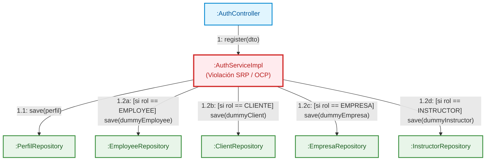
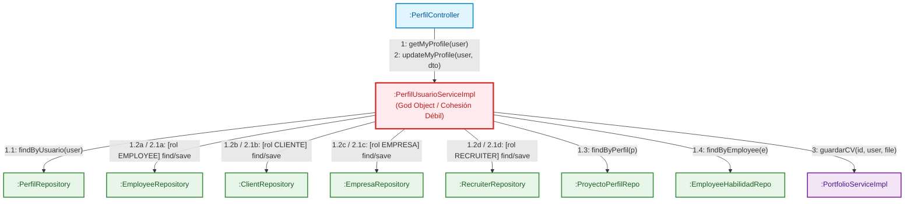
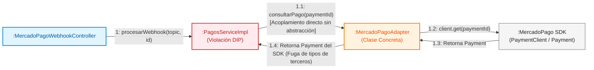
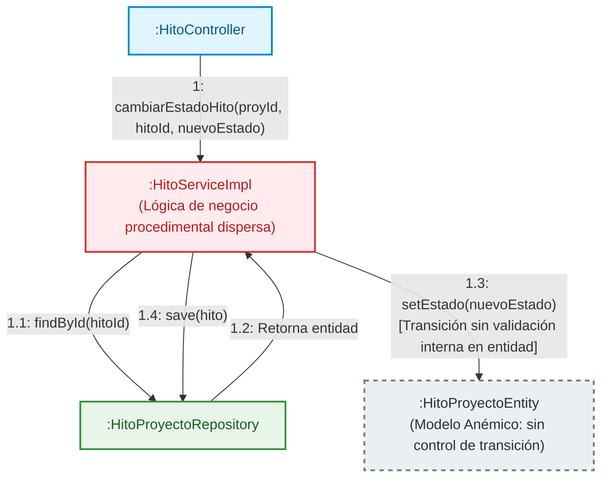

# Documento Técnico: Diagramas de Colaboración (Comunicación UML)
## Análisis de Arquitectura y Patrones GRASP, SOLID y GoF — WorkLink Platform

**Materia:** Programación III / Trabajo Práctico Final  
**Proyecto:** WorkLink Platform Backend  
**Fecha:** Noviembre 2026  

---

## 1. Introducción

El presente documento recopila los **Diagramas de Colaboración (también denominados Diagramas de Comunicación en UML 2.x)** que evidencian gráficamente los principales problemas arquitectónicos, violaciones de principios **SOLID**, directivas **GRASP** y la ausencia de patrones de diseño **GoF** en la plataforma WorkLink.

A diferencia del diagrama de secuencias (centrado en la línea de tiempo vertical), el diagrama de colaboración se enfoca en la **red estructural de objetos y la interacción mediante mensajes numerados cronológicamente** (`1`, `1.1`, `1.2`, etc.).

---

## 2. Diagrama 1: Módulo de Registro de Usuarios
### Violación de SRP, OCP, Low Coupling y Falta del Patrón Observer (GoF)

* **Componentes afectados:** `AuthController` $\rightarrow$ `AuthServiceImpl` $\rightarrow$ Repositorios de Módulos.
* **Diagnóstico:** `AuthServiceImpl` actúa fuera de su ámbito de responsabilidad única (SRP). Además de validar credenciales y crear la cuenta `PerfilEntity`, conoce los repositorios de 4 módulos de negocio ajenos (`Employee`, `Client`, `Empresa`, `Instructor`) y genera registros incompletos con datos ficticios mediante sentencias `if-else` (violación de Open/Closed Principle y Creator de GRASP).
* **Patrón GoF Omitido:** **Observer (Event-Driven interno con Spring Events)** mediante `ApplicationEventPublisher`.

### 2.1 Diagrama de Comunicación UML

### 2.2 Tabla de Mensajes y Justificación Técnica

| N.º Mensaje | Objeto Emisor | Objeto Receptor | Método Invocado | Problema Arquitectónico |
| :--- | :--- | :--- | :--- | :--- |
| **`1`** | `:AuthController` | `:AuthServiceImpl` | `register(perfilRequestDTO)` | Solicitud HTTP de registro de cuenta. |
| **`1.1`** | `:AuthServiceImpl` | `:PerfilRepository` | `save(perfilEntity)` | Persistencia de credenciales e identidad base (Correcto). |
| **`1.2a`** | `:AuthServiceImpl` | `:EmployeeRepository` | `save(employeeEntity)` | **Fuerte Acoplamiento:** `AuthService` conoce la estructura interna del módulo de Empleo. |
| **`1.2b`** | `:AuthServiceImpl` | `:ClientRepository` | `save(clientEntity)` | **Violación OCP:** Si surge un nuevo rol, se debe modificar este método con otro `else if`. |
| **`1.2c`** | `:AuthServiceImpl` | `:EmpresaRepository` | `save(empresaEntity)` | **Violación Creator:** `AuthService` no debería tener la responsabilidad de instanciar empresas. |
| **`1.2d`** | `:AuthServiceImpl` | `:InstructorRepository` | `save(instructorEntity)` | Acopla dependencias de módulos excluidos o secundarios. |

---

## 3. Diagrama 2: Módulo de Gestión de Perfiles
### Violación de Alta Cohesión, Polimorfismo (GRASP) y God Object

* **Componentes afectados:** `PerfilController` $\rightarrow$ `PerfilUsuarioServiceImpl`.
* **Diagnóstico:** `PerfilUsuarioServiceImpl` presenta cohesión extremadamente baja (**God Object**). Inyecta 10 dependencias y administra por la fuerza todas las variantes de usuario del sistema mediante bifurcaciones condicionales (`if rol == ...`), en lugar de emplear polimorfismo.
* **Patrón GoF Omitido:** **Strategy Pattern** (`ProfileHandlerStrategy`) o **Facade**.

### 3.1 Diagrama de Comunicación UML

### 3.2 Tabla de Mensajes y Justificación Técnica

| N.º Mensaje | Objeto Emisor | Objeto Receptor | Método Invocado | Problema Arquitectónico |
| :--- | :--- | :--- | :--- | :--- |
| **`1`** | `:PerfilController` | `:PerfilUsuarioServiceImpl` | `getMyProfile(username)` | Petición para obtener datos unificados del perfil. |
| **`1.1`** | `:PerfilUsuarioServiceImpl` | `:PerfilRepository` | `findByUsuario(username)` | Busca entidad base de seguridad. |
| **`1.2a..d`** | `:PerfilUsuarioServiceImpl` | Varios Repositorios | `findByPerfil(perfil)` | **Falta de Polimorfismo:** Resuelve con cadenas `if-else` en vez de delegar en un `Strategy` especializado por rol. |
| **`1.3 / 1.4`** | `:PerfilUsuarioServiceImpl` | Repositorios auxiliares | Consultas de portafolio y habilidades | Mezcla responsabilidades de contenido multimedia y competencias técnicas dentro del servicio de perfil. |
| **`3`** | `:PerfilUsuarioServiceImpl` | `:PortfolioServiceImpl` | `guardarCV(id, user, file)` | **Acoplamiento Directo:** Delegación manual hacia servicios de otros dominios. |

---

## 4. Diagrama 3: Módulo de Pagos y Liquidaciones
### Violación de Dependency Inversion (DIP), Variaciones Protegidas y Falta de Adapter GoF

* **Componentes afectados:** `MercadoPagoWebhookController` $\rightarrow$ `PagosServiceImpl` $\rightarrow$ `MercadoPagoAdapter`.
* **Diagnóstico:** `PagosServiceImpl` depende directamente de una clase concreta (`MercadoPagoAdapter`) y maneja clases de transporte del SDK de terceros (`com.mercadopago.resources.payment.Payment`). Esto imposibilita desacoplar la aplicación para incorporar pasarelas alternativas (ej. Stripe) o simular respuestas en pruebas unitarias con mocks.
* **Patrón GoF Omitido:** **Adapter Pattern formal** (con interfaz de dominio `IPaymentGateway`).

### 4.1 Diagrama de Comunicación UML

### 4.2 Tabla de Mensajes y Justificación Técnica

| N.º Mensaje | Objeto Emisor | Objeto Receptor | Método Invocado | Problema Arquitectónico |
| :--- | :--- | :--- | :--- | :--- |
| **`1`** | `:WebhookController` | `:PagosServiceImpl` | `procesarWebhook(topic, id)` | Recepción asíncrona de notificación IPN de Mercado Pago. |
| **`1.1`** | `:PagosServiceImpl` | `:MercadoPagoAdapter` | `consultarPago(paymentId)` | **Violación DIP:** Invocación a clase concreta sin una interfaz abstracta intermedia (`IPaymentGateway`). |
| **`1.2`** | `:MercadoPagoAdapter` | SDK Mercado Pago | `client.get(paymentId)` | Llamada HTTP externa al servidor de Mercado Pago. |
| **`1.4`** | `:MercadoPagoAdapter` | `:PagosServiceImpl` | Retorno de objeto `Payment` | **Fuga de Abstracción:** El modelo interno de Mercado Pago contamina la capa de servicio de la aplicación. |

---

## 5. Diagrama 4: Módulo Freelance (Hitos y Proyectos)
### Violación de Information Expert y Falta del Patrón State (GoF)

* **Componentes afectados:** `HitoController` $\rightarrow$ `HitoServiceImpl` $\rightarrow$ `HitoProyectoEntity`.
* **Diagnóstico:** El servicio trata a la entidad como una estructura de datos pasiva (**Modelo de Dominio Anémico**). Las reglas de transición de estados se implementan procedimentalmente en la capa de servicios con setters públicos (`setEstado(nuevoEstado)`), permitiendo transiciones inconsistentes (por ejemplo, saltar de `PENDIENTE` a `PAGADO` sin haber completado la entrega).
* **Patrón GoF Omitido:** **State Pattern** (o encapsulamiento en el Aggregate Root según DDD / GRASP Information Expert).

### 5.1 Diagrama de Comunicación UML

### 5.2 Tabla de Mensajes y Justificación Técnica

| N.º Mensaje | Objeto Emisor | Objeto Receptor | Método Invocado | Problema Arquitectónico |
| :--- | :--- | :--- | :--- | :--- |
| **`1`** | `:HitoController` | `:HitoServiceImpl` | `cambiarEstadoHito(...)` | Endpoint para avanzar el estado de entrega o pago de un hito. |
| **`1.1`** | `:HitoServiceImpl` | `:HitoProyectoRepository` | `findById(hitoId)` | Carga de entidad desde base de datos. |
| **`1.3`** | `:HitoServiceImpl` | `:HitoProyectoEntity` | `setEstado(nuevoEstado)` | **Violación Information Expert:** La entidad no valida si el nuevo estado es coherente con su estado actual. |
| **`1.4`** | `:HitoServiceImpl` | `:HitoProyectoRepository` | `save(hito)` | Persiste un estado potencialmente inconsistente. |

---

## 6. Cuadro Comparativo Global de Arquitectura

| Diagrama | Componente | Principio SOLID Vulnerado | Principio GRASP Vulnerado | Patrón GoF de Solución |
| :--- | :--- | :--- | :--- | :--- |
| **1. Registro** | `AuthServiceImpl` | **Single Responsibility (SRP)** **Open/Closed (OCP)** | **Low Coupling** **Creator** | **Observer** (Spring Application Events) |
| **2. Perfiles** | `PerfilUsuarioServiceImpl` | **Single Responsibility (SRP)** | **High Cohesion** **Polymorphism** **Protected Variations** | **Strategy Pattern** **Facade** |
| **3. Pagos** | `PagosServiceImpl` | **Dependency Inversion (DIP)** | **Protected Variations** **Low Coupling** | **Adapter Pattern** (con interfaz `IPaymentGateway`) |
| **4. Hitos** | `HitoServiceImpl` | **Single Responsibility (SRP)** | **Information Expert** | **State Pattern** |
