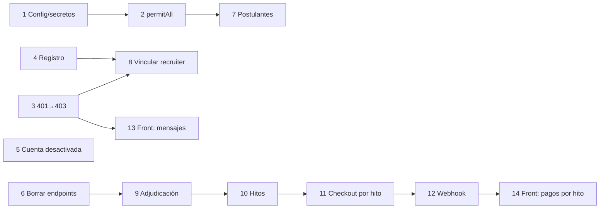

# Implementation Plan — Correcciones críticas de seguridad, pagos y contratos

| Campo | Valor |
|---|---|
| **Fase / Módulo** | Cierre del MVP — Seguridad transversal, Gestión Corporativa y Pasarela de Pagos |
| **Subdominios** | Autenticación (perfil), Enterprise (vacantes, postulaciones, recruiters), Freelance (pagos, webhook) |
| **Requisitos que corrige** | RF01, RF08, RF11, RF14, RF19, RF27, RF28, RF29, RF30 · RNF04, RNF05, RNF07, RNF09 · INC-02 del dossier |
| **Repos afectados** | Backend `Proyecto-Final-Progra-3` (pasos 1–12) · Frontend `WorkLink` (pasos 13 y 14) |
| **Estado** | ✅ Pasos 1 a 8 **aplicados y probados** contra el backend local (12/11/2026, sin commit). Pasos 9 a 14 pendientes de aprobación ("Acepto el plan, ejecuta el paso N"). |

**Decisión ya tomada:** los recruiters **se registran solos** (RF01). La empresa los **vincula** a su nómina con el email (RF11).

---

## 0. Reglas de negocio confirmadas (base de los pasos 9 a 14)

| # | Decisión | Dónde se aplica |
|---|---|---|
| D1 | El **pago directo** (sin Mercado Pago) **no está en el alcance**: se borra. | Paso 11 |
| D2 | Se paga **antes** de cada hito. Sin pago el hito no empieza; con el pago confirmado, el hito pasa a `EN_PROGRESO`. | Pasos 10, 11 y 12 |
| D3 | El **monto acordado** (el costo de la propuesta aceptada, que no puede superar `presupuestoMax`) se reparte **en partes iguales** entre los hitos. Ejemplo: 2000 en 4 hitos = 500 cada uno. | Pasos 9 y 10 |
| D4 | El hito pagado es **un solo estado** (`EN_PROGRESO`): el freelancer lo ve como **"Pagado"** y el cliente como **"En progreso"**. | Pasos 10 y 14 |
| D5 | Los hitos se pagan y se trabajan **en orden**, de a uno. Cuando se completa el último, el proyecto pasa solo a `FINALIZADO`. | Pasos 10 y 11 |
| D6 | Todos los montos están en **pesos (ARS)**, que es la moneda que cobra Mercado Pago Checkout Pro en Argentina. | Pasos 11 y 12 |

**Ciclo resultante:** propuesta → adjudicación (se fija el monto acordado) → el cliente crea los hitos (montos automáticos) → paga el hito 1 → el webhook lo pasa a `EN_PROGRESO` → el freelancer lo marca `COMPLETADO` → se habilita el pago del hito 2 → … → se completa el último → el proyecto queda `FINALIZADO`.

---

## Paso 1 — Secretos y configuración (RNF04, RNF05, INC-02)

**¿Qué hace?** Saca los secretos del repo, alinea la configuración con lo que dice el dossier y arregla la subida de CVs de más de 1 MB.

**¿Por qué?**
- `jwt.secret` tiene un valor por defecto en `application.yml`. Si falta la variable de entorno, la app arranca con una clave pública y cualquiera puede **fabricar tokens válidos**.
- `docker-compose.yml` está en git con un `JWT_SECRET` real y con `root/root`.
- El dossier (INC-02) dice que se configuró `max-file-size=5MB`, pero esa línea no existe. Spring usa 1 MB por defecto.

### 1.a `src/main/resources/application.yml`

```yaml
spring:
  # ...lo que ya está...
  servlet:
    multipart:
      max-file-size: 5MB      # INC-02: CV en PDF de hasta 5 MB (RF06)
      max-request-size: 6MB   # 5 MB de archivo + campos del formulario
  datasource:
    hikari:
      maximum-pool-size: 15   # RNF04 (antes 30)
      minimum-idle: 5

jwt:
  secret: ${JWT_SECRET}                  # sin valor por defecto: si falta, la app NO arranca (es lo que queremos)
  expiration: ${JWT_EXPIRATION:36000000} # 10 h, como dice RNF05 (antes 24 h)

app:
  frontend-url: ${FRONTEND_URL:http://localhost:4200}   # usado en el paso 11 para las URLs de retorno de Mercado Pago
```

### 1.b `.env` local (ya está en `.gitignore`)

> **Corrección al aplicar:** `spring-dotenv` 4.0 **no carga el `.env` con Spring Boot 4**. `${JWT_SECRET}` quedaba como texto literal y el login respondía 500 (`WeakKeyException`). Se reemplazó por la función nativa de Spring Boot, `spring.config.import: optional:file:.env[.properties]`, en `application.yml`. Además, `JwtProperties` ahora tiene `@Validated` con `@Size(min = 32)`: si el secreto falta o es débil, la app **no arranca** y el mensaje dice qué falta. La dependencia `spring-dotenv` quedó sin uso y se puede sacar del `pom.xml`.

```dotenv
JWT_SECRET=<mínimo 32 caracteres aleatorios; generalo con: openssl rand -base64 48>
DB_PASSWORD=<tu contraseña local>
MERCADOPAGO_ACCESS_TOKEN=TEST-xxxxxxxx
```

### 1.c `docker-compose.yml`: reemplazar los valores literales

```yaml
  db:
    environment:
      MYSQL_ROOT_PASSWORD: ${DB_PASSWORD}
    ports:
      - "127.0.0.1:3306:3306"   # MySQL solo accesible desde tu máquina, no desde la red
    healthcheck:
      test: ["CMD-SHELL", "mysqladmin ping -h localhost || exit 1"]   # ping no necesita contraseña
  backend:
    environment:
      DB_PASSWORD: ${DB_PASSWORD}
      SPRING_DATASOURCE_PASSWORD: ${DB_PASSWORD}
      JWT_SECRET: ${JWT_SECRET}
```
Borrar `MYSQL_USER` y `MYSQL_PASSWORD` (`app_user`), porque el backend no los usa.

> ⚠ **Rotar el secreto:** el `JWT_SECRET` viejo quedó en el historial de git. Usá uno nuevo, no el que estaba en el compose.

**Cómo verificar:** sin `JWT_SECRET` en el `.env`, `mvnw spring-boot:run` tiene que fallar al arrancar. Con la variable, arranca. Subí un PDF de 3 MB desde Mi Perfil: tiene que devolver 200, no 413.

---

## Paso 2 — Endpoints que quedaron públicos por error (RF19, filtración de datos personales)

**¿Qué hace?** Reemplaza los comodines `/*` de `permitAll` por rutas exactas.

**¿Por qué?** `GET /api/v1/vacantes/*` también abarca `/api/v1/vacantes/postulaciones`. Por eso **cualquiera, sin login**, puede pedir `?vacanteId=1` y obtener nombre y email de todos los postulantes. Por la misma razón `/vacantes/me`, `/freelance/proyectos/historico` y `/perfiles/me/calificaciones` son "públicos", y sin token terminan en un 500 por NPE en lugar de un 401.

### `config/security/SecurityConfig.java`: reemplazar las líneas de `permitAll` de GET

```java
// {id:\\d+} solo acepta números: "/me", "/postulaciones" o "/historico" ya no coinciden
.requestMatchers(HttpMethod.GET, "/api/v1/bootcamps", "/api/v1/bootcamps/{id:\\d+}", "/api/v1/bootcamps/disponibles", "/api/v1/bootcamps/modalidad/*").permitAll()
.requestMatchers(HttpMethod.GET, "/api/v1/vacantes", "/api/v1/vacantes/{id:\\d+}", "/api/v1/vacantes/uuid/*").permitAll()
.requestMatchers(HttpMethod.GET, "/api/v1/freelance/proyectos", "/api/v1/freelance/proyectos/{id:\\d+}", "/api/v1/freelance/proyectos/uuid/*").permitAll()
.requestMatchers(HttpMethod.GET, "/api/v1/perfiles/{perfilId:\\d+}/calificaciones").permitAll()
```
Se **borran** de `permitAll` `/api/v1/perfiles/me/calificaciones` y `/api/v1/freelance/calificaciones/me`: tienen "me", así que necesitan login. El front ya manda el token.

El paso 7 agrega además el control de dueño en el servicio, porque la seguridad no tiene que depender de una sola capa.

**Cómo verificar:** `curl "http://localhost:8080/api/v1/vacantes/postulaciones?vacanteId=1"` sin token tiene que devolver **401**. `curl http://localhost:8080/api/v1/vacantes/1` sin token tiene que seguir devolviendo 200.

---

## Paso 3 — "No tenés permiso" no debe cerrar la sesión (contrato front ↔ back)

**¿Qué hace?** `UnauthorizedAccessException` pasa a responder **403** en lugar de 401. Los 401 reales (login fallido, cuenta desactivada, token de Google inválido) pasan a usar las excepciones de Spring Security.

**¿Por qué?** Unas 30 validaciones de "no sos el dueño" responden 401. El `errorInterceptor` del front interpreta 401 como "token vencido" y hace `logout()`. Resultado: un recruiter que toca algo sin permiso **pierde la sesión**.

### 3.a `exceptions/system/GlobalExceptionHandler.java`

```java
// HTTP 403 - Autenticado, pero sin permiso sobre este recurso
@ExceptionHandler(UnauthorizedAccessException.class)
public ResponseEntity<ErrorResponseDTO> handleUnauthorizedAccessException(UnauthorizedAccessException ex) {
    ErrorResponseDTO error = new ErrorResponseDTO("Acceso denegado", List.of(ex.getMessage()), LocalDate.now());
    return new ResponseEntity<>(error, HttpStatus.FORBIDDEN);
}
```
En `handleBadCredentials`, traducir el mensaje en inglés de Spring:
```java
String detalle = ex instanceof BadCredentialsException
        ? "Usuario o contraseña incorrectos"
        : (ex.getMessage() != null ? ex.getMessage() : "No se pudo autenticar la solicitud");
```

### 3.b Los 4 casos que sí son 401: cambiar la excepción

| Archivo | Línea | Antes | Después |
|---|---|---|---|
| `AuthServiceImpl.java` | 122 | `UnauthorizedAccessException("Autenticación fallida: perfil nulo")` | `BadCredentialsException("Autenticación fallida: no se pudo cargar el perfil")` |
| `AuthServiceImpl.java` | 126 | `UnauthorizedAccessException("El perfil ... desactivado.")` | `DisabledException("El perfil de usuario se encuentra desactivado.")` |
| `GoogleAuthServiceImpl.java` | 69 | ídem desactivado | `DisabledException(...)` (mismo mensaje) |
| `GoogleAuthServiceImpl.java` | 92 y 99 | `UnauthorizedAccessException(...)` | `BadCredentialsException(...)` (mismos mensajes) |

Imports: `org.springframework.security.authentication.BadCredentialsException` y `org.springframework.security.authentication.DisabledException`. Las dos extienden `AuthenticationException`, que el handler ya convierte en 401.

**Cómo verificar:** con el token de un FREELANCER, `PUT /api/v1/freelance/proyectos/{id}` sobre un proyecto ajeno tiene que devolver **403**, y el front **no** tiene que mandarte al login.

---

## Paso 4 — Registro: roles válidos y email único (RF01, RF03)

**¿Qué hace?** El registro solo acepta los 5 roles del dossier, nunca crea roles nuevos, rechaza emails duplicados, y Google exige que el email esté verificado.

**¿Por qué?** Hoy `{"rol":"ADMIN"}` **crea** el rol y el usuario queda con él. `"INSTRUCTOR"` da acceso a bootcamps. Si `rol` viene vacío, la respuesta es un 500. Además, como el email no es único en la práctica ni se verifica en Google, se puede tomar una cuenta ajena por el email.

### 4.a `dto/requestdto/PerfilRequestDTO.java`

```java
public record PerfilRequestDTO(
        @NotBlank(message = "El usuario es obligatorio")
        @Size(min = 3, max = 50, message = "El usuario debe tener entre 3 y 50 caracteres") String usuario,
        @NotBlank(message = "El email es obligatorio")
        @Email(message = "El email no tiene un formato válido") String email,
        @NotBlank(message = "La contraseña es obligatoria")
        @Size(min = 8, message = "La contraseña debe tener al menos 8 caracteres") String password,
        // RF01: los 5 roles registrables. INSTRUCTOR queda fuera (bootcamps diferido, ADR-002)
        @NotBlank(message = "El rol es obligatorio")
        @Pattern(regexp = "POSTULANTE|FREELANCER|EMPRESA|RECRUITER|CLIENTE",
                 message = "El rol debe ser POSTULANTE, FREELANCER, EMPRESA, RECRUITER o CLIENTE") String rol
) {}
```
`AuthController.registrar` ya tiene `@Valid`, así que no hace falta tocarlo.

### 4.b `AuthServiceImpl.register`: reemplazar el bloque que crea el rol

```java
if (perfilRepository.findByEmail(dto.email()).isPresent()) {
    throw new BusinessRuleException("El email " + dto.email() + " ya se encuentra registrado");
}
// ...
RolEntity rol = rolRepository.findByNombre(dto.rol().toUpperCase());
if (rol == null) {
    // Nunca se crean roles desde la API: si falta, la base no tiene los datos semilla
    throw new ResourceNotFoundException("El rol " + dto.rol() + " no está configurado en la base de datos (revisar bd_proyecto_final.sql)");
}
perfil.setRol(rol);
```
Para el caso RECRUITER no se crea nada: la empresa lo vincula después (paso 8).

### 4.c `GoogleAuthServiceImpl`

En `authenticateGoogle`, justo después de `verifyGoogleToken`:
```java
if (!Boolean.TRUE.equals(payload.getEmailVerified())) {
    throw new BadCredentialsException("La cuenta de Google no tiene el email verificado");
}
```
En `findOrCreatePerfil`, reemplazar el bloque `if (rol == null) { rol = new RolEntity(); ... }` por:
```java
// Mismos 5 roles que PerfilRequestDTO (RF01)
if (!Set.of("POSTULANTE", "FREELANCER", "EMPRESA", "RECRUITER", "CLIENTE").contains(rolNombre)) {
    throw new BadRequestException("Rol no permitido para el registro: " + rolNombre);
}
if (rol == null) {
    throw new ResourceNotFoundException("El rol " + rolNombre + " no está configurado en la base de datos (revisar bd_proyecto_final.sql)");
}
```
Imports: `java.util.Set`, `...exceptions.domain.BadRequestException`, `...exceptions.domain.ResourceNotFoundException` y `org.springframework.security.authentication.BadCredentialsException`.

**Cómo verificar:** `POST /auth/register` con `"rol":"ADMIN"` → 400 con el mensaje del `@Pattern`. Repetir un email → 422 "El email ... ya se encuentra registrado". Con `rol` vacío → 400, no 500.

> ⚠ **Límite conocido:** el registro local sigue sin verificar el email (no hay envío de correo en el alcance). Mientras tanto, el email único impide registrar dos cuentas con el mismo email, pero no impide que alguien registre primero el email de otra persona.

---

## Paso 5 — Cuenta desactivada = token inválido (RF08)

**¿Qué hace?** El filtro JWT rechaza los tokens de perfiles dados de baja.

**¿Por qué?** RF08 dice que la baja lógica "inhabilita el acceso". Hoy, después de `DELETE /perfiles/me`, el token sigue funcionando hasta que vence.

### `config/security/JwtAuthenticationFilter.java`

```java
if (userDetails instanceof PerfilEntity perfil && perfil.is_active()
        && jwtService.isTokenValid(token, userDetails)) {
```
Import: `com.example.Proyecto_Final_Progra3.model.PerfilEntity`.

**Cómo verificar:** guardar un token, llamar a `DELETE /perfiles/me`, y usar ese mismo token en `GET /perfiles/getProfile` → **401**.

---

## Paso 6 — Borrar los endpoints que permiten actuar en nombre de otro (RF14, RF18, RF22, RF26)

**¿Qué hace?** Elimina las versiones "sin `/me`" de los endpoints, que reciben en el body el ID del dueño.

**¿Por qué?** Con estos endpoints, cualquier usuario autenticado crea vacantes de otra empresa, proyectos de otro cliente o postulaciones de otro freelancer. **El front no los usa**: lo verifiqué en todos los `.post(...)` y llama siempre a `/me`.

| Controlador | Método a borrar | Ruta |
|---|---|---|
| `VacanteController` | `crearVacante` | `POST /api/v1/vacantes` |
| `ProyectoController` | `crearProyecto` | `POST /api/v1/freelance/proyectos` |
| `PostulacionProyectoController` | `enviarPropuesta` | `POST /api/v1/freelance/proyectos/{id}/postulaciones` |
| `PostulacionVacanteController` | `postularse` | `POST /api/v1/vacantes/{id}/postulaciones` |
| `InscripcionController` | `realizarInscripcion` | `POST /api/v1/inscripciones/{b}/empleados/{e}` |
| `BootcampController` | `crearBootcamp` | `POST /api/v1/bootcamps` |

**Cuidado con el servicio:** casi todas las versiones `/me` **delegan** en el método que se elimina. Por ejemplo, `crearMiProyecto` llama a `crearProyecto(dtoConCliente)`. Lo verifiqué uno por uno:

| Método del servicio | ¿Lo usa la versión `/me`? | Qué hacer |
|---|---|---|
| `VacanteServiceImpl.crearVacante` | Sí (`crearMiVacante`; se detectó al aplicar) | Ídem: `private` y fuera de la interfaz |
| `ProyectoServiceImpl.crearProyecto` | Sí (`crearMiProyecto`) | Quitarlo de `IProyectoService`, sacarle `@Override` y hacerlo `private` |
| `PostulacionProyectoServiceImpl.postularse` | Sí (`postularseMe`) | Ídem: `private` y fuera de la interfaz |
| `PostulacionVacanteServiceImpl.postularse` | Sí (`postularseMe`) | Ídem |
| `InscripcionServiceImpl.realizarInscripcion` | Sí (`realizarMiInscripcion`) | Ídem |
| `BootcampServiceImpl.crearBootcamp` | Sí (`crearMiBootcamp`) | Ídem |

Así nadie puede llamarlos desde afuera, pero la lógica sigue funcionando.

**`POST /api/v1/empresas` sí lo usa el front**, así que no se borra. Se cambia para que tome el perfil del token en lugar de `dto.perfil_id()`:

```java
// EmpresaController
public ResponseEntity<EmpresaResponseDTO> crearEmpresa(Authentication authentication, @Valid @RequestBody EmpresaRequestDTO dto) {
    return new ResponseEntity<>(empresaService.crearEmpresa(authentication.getName(), dto), HttpStatus.CREATED);
}

// EmpresaServiceImpl.crearEmpresa(String username, EmpresaRequestDTO dto)
PerfilEntity perfil = perfilRepository.findByUsuario(username)
        .orElseThrow(() -> new ResourceNotFoundException("Usuario no encontrado: " + username));
if (empresaRepository.findByPerfil(perfil).isPresent()) {
    throw new BusinessRuleException("Tu cuenta ya tiene una empresa registrada; editala en lugar de crear otra");
}
```
`perfil_id` queda en `EmpresaRequestDTO` pero se ignora. Se puede borrar más adelante, junto con el front.

**Cómo verificar:** `mvnw compile` sin errores. Swagger ya no muestra esas rutas. Publicar una vacante y un proyecto desde el front sigue funcionando.

---

## Paso 7 — Solo la empresa o su recruiter ven los postulantes (RF19)

**¿Qué hace?** `listarPostulantes` exige que el usuario sea la empresa dueña de la vacante o un recruiter de esa empresa. **Reutiliza la validación que ya existe** en `cambiarEstado`.

### `PostulacionVacanteServiceImpl.java`

1. Mover el bloque `boolean autorizado = ... if (!autorizado) throw ...` de `cambiarEstado` a un método privado:

```java
// Empresa dueña de la vacante o recruiter de esa misma empresa
private void validarGestionVacante(VacanteEntity vacante, String username) {
    PerfilEntity perfil = perfilRepository.findByUsuario(username)
            .orElseThrow(() -> new ResourceNotFoundException("Usuario no encontrado: " + username));
    boolean esEmpresa = vacante.getEmpresa() != null && vacante.getEmpresa().getPerfil() != null
            && vacante.getEmpresa().getPerfil().getUsuario().equals(username);
    boolean esRecruiter = vacante.getEmpresa() != null && recruiterRepository.findByPerfil(perfil)
            .map(r -> r.getEmpresa() != null && r.getEmpresa().getId().equals(vacante.getEmpresa().getId()))
            .orElse(false);
    if (!esEmpresa && !esRecruiter) {
        throw new UnauthorizedAccessException("Solo la empresa dueña de la vacante o sus recruiters pueden gestionar sus postulaciones");
    }
}
```
2. En `cambiarEstado`, reemplazar el bloque por `validarGestionVacante(postulacion.getVacante(), username);`.
3. `listarPostulantes(Integer vacanteId, String username)`:

```java
VacanteEntity vacante = vacanteRepository.findById(vacanteId)
        .orElseThrow(() -> new ResourceNotFoundException("Vacante no encontrada con ID: " + vacanteId));
validarGestionVacante(vacante, username);
return postulacionVacanteMapper.toDtoList(postulacionRepository.findByVacante_VacanteId(vacanteId));
```
4. Actualizar la firma en `IPostulacionVacanteService` y los **dos** lugares que la llaman: `PostulacionVacanteController:55` y `VacanteController:36`. En los dos se pasa `authentication.getName()`.

**Cómo verificar:** con el token de la empresa A, pedir los postulantes de una vacante de la empresa B → 403. Con el de la empresa A, sobre una vacante propia → 200.

---

## Paso 8 — La empresa vincula al recruiter que se registró (RF01 + RF11 + RF14)

**¿Qué hace?** Cuando la empresa da de alta un recruiter, el backend busca la cuenta RECRUITER que ya existe con ese email y la vincula.

**¿Por qué?** Hoy el flujo está cortado en los dos extremos:
- `crearRecruiter` guarda `perfil = null`, y la tabla `recruiter` define `perfil_id INT NOT NULL UNIQUE`. **El alta falla siempre** con un 409 ("Column 'perfil_id' cannot be null").
- Un recruiter que se registra solo nunca queda asociado a nada, así que no puede crear vacantes.
- En la demo solo funcionan Ana, Sofía y Lucas porque vienen del seed.

**Flujo resultante:** (1) el recruiter se registra con el rol Recruiter → (2) la empresa lo da de alta en "Recruiters" con ese email → (3) el recruiter ya puede gestionar las vacantes de la empresa.

### `RecruiterServiceImpl.crearRecruiter`: después de `existsByEmail`

```java
// RF01 + RF11: el recruiter se registra solo; la empresa lo vincula por email
PerfilEntity perfil = perfilRepository.findByEmail(dto.email())
        .filter(p -> "RECRUITER".equalsIgnoreCase(p.getRol().getNombre()))
        .orElseThrow(() -> new BusinessRuleException(
                "No existe una cuenta de WorkLink con rol Recruiter y email " + dto.email()
                + ". El recruiter debe registrarse primero con ese email."));
if (recruiterRepository.findByPerfil(perfil).isPresent()) {
    throw new BusinessRuleException("La cuenta " + dto.email() + " ya está asociada a una empresa");
}

RecruiterEntity recruiter = recruiterMapper.toEntity(dto);
recruiter.setEmpresa(empresa);
recruiter.setPerfil(perfil);
```
`perfilRepository` ya está inyectado en esa clase, así que no hace falta agregar dependencias.

**Mensaje para el recruiter que todavía no fue vinculado:** con el paso 3, el `UnauthorizedAccessException` de `VacanteServiceImpl` (líneas 70, 119 y 137) ya responde 403 sin cerrar la sesión. Para que el texto sea claro, cambiar el mensaje de la línea 70 por:
`"Solo las empresas o los recruiters vinculados a una empresa pueden crear vacantes. Si sos recruiter, pedile a la empresa que te dé de alta con tu email."`
(La misma línea también la alcanzan postulantes y freelancers, porque `/api/v1/vacantes/**` los deja pasar; por eso el mensaje no supone que quien llama es un recruiter.)

**Cómo verificar:** registrar `rec.test@ejemplo.com` como RECRUITER → entrar como empresa y dar de alta un recruiter con ese email → 200 → entrar como el recruiter y crear una vacante → 200. Dar de alta un email que no está registrado → 422 con el mensaje anterior.

> ⚠ **Pendiente fuera de alcance:** `eliminarRecruiter` hace borrado físico, y RF11 pide baja lógica. La tabla no tiene `is_active`, así que requiere decidir el modelo. Además, si `actualizarRecruiter` cambia el email, el recruiter queda desincronizado de su cuenta.

---

## Paso 9 — La adjudicación guarda el monto acordado (RF27, D3)

**¿Qué hace?** Al adjudicar, el backend exige que el freelancer se haya postulado, marca su propuesta como `ACEPTADA` y usa el **costo de esa propuesta como monto acordado**. Al postularse, la propuesta no puede superar `presupuestoMax`.

**¿Por qué?** Hoy `PUT /proyectos/{id}/asignar?employeeId=N` acepta **cualquier** `employeeId`, aunque esa persona no se haya postulado, y la propuesta nunca pasa a `ACEPTADA`. Sin ese dato, el sistema no sabe cuánto se acordó y no se puede repartir en hitos (paso 10).

### 9.a `PostulacionProyectoRepository.java`

```java
Optional<PostulacionProyectoEntity> findByProyecto_IdAndEmployee_EmployeeId(Integer proyectoId, Integer employeeId);
Optional<PostulacionProyectoEntity> findByProyecto_IdAndEstado(Integer proyectoId, EstadoPostulacionProyecto estado);
boolean existsByProyecto_IdAndEmployee_EmployeeId(Integer proyectoId, Integer employeeId);
```

### 9.b `PostulacionProyectoServiceImpl.postularse` (queda `private` después del paso 6), antes de crear la entidad

```java
if (proyecto.getEstado() != EstadoProyecto.BUSCANDO_TALENTO) {
    throw new BusinessRuleException("El proyecto ya no recibe propuestas (estado actual: " + proyecto.getEstado() + ")");
}
// D3: lo acordado nunca supera el presupuesto máximo del proyecto
if (dto.costo().compareTo(proyecto.getPresupuestoMax()) > 0) {
    throw new BusinessRuleException("Tu propuesta ($" + dto.costo() + ") supera el presupuesto máximo del proyecto ($" + proyecto.getPresupuestoMax() + ")");
}
if (postulacionRepository.existsByProyecto_IdAndEmployee_EmployeeId(proyectoId, employee.getEmployeeId())) {
    throw new BusinessRuleException("Ya enviaste una propuesta a este proyecto");
}
```
El control de duplicados también evita que el `Optional` de 9.c falle con "más de un resultado".

### 9.c `ProyectoServiceImpl.asignarFreelancer`: reemplazar la búsqueda del freelancer

```java
// RF27: solo se adjudica a quien se postuló; su costo propuesto pasa a ser el monto acordado
PostulacionProyectoEntity propuesta = postulacionProyectoRepository
        .findByProyecto_IdAndEmployee_EmployeeId(proyectoId, employeeId)
        .orElseThrow(() -> new BusinessRuleException("El freelancer " + employeeId + " no envió una propuesta a este proyecto"));
propuesta.setEstado(EstadoPostulacionProyecto.ACEPTADA);
postulacionProyectoRepository.save(propuesta);

proyecto.setFreelancer(propuesta.getEmployee());
proyecto.setEstado(EstadoProyecto.EN_PROGRESO);
```
Hay que inyectar `private final PostulacionProyectoRepository postulacionProyectoRepository;` en `ProyectoServiceImpl`, porque hoy no lo tiene. `employeeRepository.findById(employeeId)` deja de ser necesario en este método.

> ℹ️ Las demás propuestas quedan en `PENDIENTE`. Si querés que pasen a `RECHAZADA` al adjudicar, es una línea más, pero no la agrego sin que lo confirmes.

**Cómo verificar:** adjudicar con un `employeeId` que no se postuló → 422. Adjudicar a un postulante → 200, y su propuesta queda `ACEPTADA`. Postularse con un costo mayor a `presupuestoMax` → 422.

---

## Paso 10 — Hitos: pago por adelantado, reparto en partes iguales y orden (D2, D3, D4, D5)

**¿Qué hace?** Cambia el ciclo de vida del hito a `PENDIENTE → EN_PROGRESO → COMPLETADO` y reparte el monto acordado en partes iguales. Además, el freelancer solo puede completar un hito que ya fue pagado, y el proyecto se finaliza solo cuando se completa el último.

**¿Por qué?** El modelo actual paga al final (`COMPLETADO → PAGADO`), deja que el cliente ponga cualquier monto y permite marcar `PAGADO` a mano sin que exista ningún pago.

### 10.a Enum y base de datos

`model/freelance/enums/EstadoHitoProyecto.java`:
```java
public enum EstadoHitoProyecto {
    PENDIENTE,    // sin pagar: el freelancer no empieza (D2)
    EN_PROGRESO,  // pagado por Mercado Pago: el freelancer lo ve como "Pagado" y el cliente como "En progreso" (D4)
    COMPLETADO    // entregado por el freelancer
}
```

En tu MySQL local, en este orden (primero se agrega el valor nuevo, se migran las filas y después se quita `PAGADO`):
```sql
ALTER TABLE hito_proyecto MODIFY estado ENUM('PENDIENTE','COMPLETADO','PAGADO','EN_PROGRESO') DEFAULT 'PENDIENTE';
UPDATE hito_proyecto SET estado = 'COMPLETADO' WHERE estado = 'PAGADO';   -- en el modelo viejo, PAGADO = terminado y cobrado
ALTER TABLE hito_proyecto MODIFY estado ENUM('PENDIENTE','EN_PROGRESO','COMPLETADO') DEFAULT 'PENDIENTE';

-- Bug aparte: el enum Java EstadoProyecto tiene CANCELADO, pero la columna no, así que cancelar un proyecto falla hoy
ALTER TABLE proyecto MODIFY estado ENUM('BUSCANDO_TALENTO','EN_PROGRESO','FINALIZADO','CANCELADO') DEFAULT 'BUSCANDO_TALENTO';
```
En `bd_proyecto_final.sql`: actualizar los dos `CREATE TABLE` con esos ENUM y cambiar `'PAGADO'` por `'COMPLETADO'` en los `INSERT INTO hito_proyecto` (filas 6 a 14).

### 10.b `HitoRequestDTO.java`: borrar el campo `monto`

El monto ya no lo elige el cliente (D3). El front lo sigue enviando hasta el paso 14, pero Jackson ignora los campos desconocidos por defecto, así que no rompe.

### 10.c `HitoProyectoRepository.java`

```java
List<HitoProyectoEntity> findByProyecto_IdOrderByHitoIdAsc(Integer proyectoId);   // orden de creación = orden de trabajo (D5)
```

### 10.d `HitoServiceImpl.crearHito`

```java
// los hitos se crean después de adjudicar: antes no hay monto acordado que repartir
if (proyecto.getEstado() != EstadoProyecto.EN_PROGRESO) {
    throw new BusinessRuleException("Solo se pueden crear hitos en proyectos adjudicados y en progreso (estado actual: " + proyecto.getEstado() + ")");
}
HitoProyectoEntity hito = HitoProyectoEntity.builder()
        .titulo(dto.titulo())
        .descripcion(dto.descripcion())
        .monto(BigDecimal.ZERO)            // lo calcula repartirMontoAcordado
        .estado(EstadoHitoProyecto.PENDIENTE)
        .fecha(dto.fechaLimite())
        .proyecto(proyecto)
        .build();
hitoRepository.save(hito);
repartirMontoAcordado(proyecto);
return mapToDto(hito);
```

Método nuevo en la misma clase:
```java
// D3: lo que falta pagar del monto acordado se reparte en partes iguales entre los hitos sin pagar
private void repartirMontoAcordado(ProyectoEntity proyecto) {
    BigDecimal acordado = postulacionProyectoRepository
            .findByProyecto_IdAndEstado(proyecto.getId(), EstadoPostulacionProyecto.ACEPTADA)
            .orElseThrow(() -> new BusinessRuleException("El proyecto no tiene una propuesta aceptada; adjudicalo antes de crear hitos"))
            .getCosto();
    List<HitoProyectoEntity> hitos = hitoRepository.findByProyecto_IdOrderByHitoIdAsc(proyecto.getId());
    BigDecimal yaPagado = hitos.stream()
            .filter(h -> h.getEstado() != EstadoHitoProyecto.PENDIENTE)
            .map(HitoProyectoEntity::getMonto)
            .reduce(BigDecimal.ZERO, BigDecimal::add);
    List<HitoProyectoEntity> pendientes = hitos.stream()
            .filter(h -> h.getEstado() == EstadoHitoProyecto.PENDIENTE)
            .toList();
    BigDecimal restante = acordado.subtract(yaPagado);
    if (restante.signum() <= 0) {
        throw new BusinessRuleException("Ya se pagó el total acordado ($" + acordado + "); no se pueden agregar más hitos");
    }
    BigDecimal parte = restante.divide(BigDecimal.valueOf(pendientes.size()), 2, RoundingMode.DOWN);
    for (int i = 0; i < pendientes.size(); i++) {
        boolean ultimo = i == pendientes.size() - 1;
        // el último hito absorbe los centavos del redondeo: 2000 / 3 = 666,66 + 666,66 + 666,68
        pendientes.get(i).setMonto(ultimo ? restante.subtract(parte.multiply(BigDecimal.valueOf(i))) : parte);
    }
    hitoRepository.saveAll(pendientes);
}
```
Si `repartirMontoAcordado` lanza una excepción, `@Transactional` deshace también el `save` del hito nuevo.

Inyecciones nuevas: `PostulacionProyectoRepository postulacionProyectoRepository`. Imports: `java.math.RoundingMode`, `EstadoProyecto` y `EstadoPostulacionProyecto`.

Ejemplo de D3: con 2000 acordados y 4 hitos, cada uno queda en 500. Si el hito 1 ya se pagó (500) y el cliente agrega un quinto hito, los 1500 restantes se reparten entre los 4 pendientes: 375 cada uno.

### 10.e `HitoServiceImpl.cambiarEstadoHito`: reemplazar las validaciones posteriores a `esCliente` y `esFreelancer`

```java
if (!esCliente && !esFreelancer) {
    throw new UnauthorizedAccessException("No tienes permisos para modificar hitos de este proyecto");
}
// D2: EN_PROGRESO solo lo pone el webhook al confirmarse el pago; a mano solo se puede completar
if (nuevoEstado != EstadoHitoProyecto.COMPLETADO) {
    throw new BusinessRuleException("El hito pasa a EN_PROGRESO solo cuando Mercado Pago confirma el pago; manualmente solo se puede marcar como COMPLETADO");
}
if (!esFreelancer) {
    throw new UnauthorizedAccessException("Solo el freelancer asignado puede marcar el hito como completado");
}
if (hito.getEstado() != EstadoHitoProyecto.EN_PROGRESO) {
    throw new BusinessRuleException("Solo se puede completar un hito pagado y en progreso (estado actual: " + hito.getEstado() + ")");
}
hito.setEstado(EstadoHitoProyecto.COMPLETADO);
HitoProyectoEntity actualizado = hitoRepository.save(hito);

// D5: cuando se completa el último hito, el proyecto se finaliza solo
if (hitoRepository.findByProyecto_Id(proyectoId).stream().allMatch(h -> h.getEstado() == EstadoHitoProyecto.COMPLETADO)) {
    proyecto.setEstado(EstadoProyecto.FINALIZADO);
    proyectoRepository.save(proyecto);
}
return mapToDto(actualizado);
```

**Cómo verificar:** adjudicar con 2000 y crear 4 hitos → `GET .../hitos` muestra 500 en cada uno. `PUT .../hitos/{id}/estado?nuevoEstado=COMPLETADO` sobre un hito `PENDIENTE` → 422. Cuando se completa el último hito, `GET /proyectos/{id}` muestra `FINALIZADO`.

---

## Paso 11 — Pagos: solo por Mercado Pago, por hito y en orden (D1, D2, D5, RF28, RF30)

**¿Qué hace?** Borra el pago directo (D1). El checkout pasa a ser **por hito**: el monto lo pone el servidor, solo paga el cliente dueño y solo el próximo hito pendiente. El historial solo lo ven el cliente y el freelancer del proyecto.

**¿Por qué?** Hoy cualquiera paga cualquier monto en cualquier proyecto, ve el historial ajeno y puede elegir a qué URL redirige Mercado Pago (`backUrl`).

### 11.a Borrar el pago directo (D1)

- `PagosController.registrarPago`, `IPagosService.registrarPago` y `PagosServiceImpl.registrarPago`.
- `PagosRequestDTO.java`: solo lo usan el pago directo y las estrategias.
- El paquete `service/freelance/strategy/` completo (`IPagoStrategy`, `PagoStrategyFactory`, `TarjetaPagoStrategy`, `BilleteraVirtualPagoStrategy`). Hay que quitar también su inyección en `PagosServiceImpl`.

> ⚠ El paquete `strategy` es el ejemplo del **patrón GoF Strategy**. Si la cátedra evalúa patrones, avisame y lo conservamos sin endpoint en lugar de borrarlo. Lo que no tiene sentido es dejar un endpoint que el alcance excluye.

### 11.b `PagosController.crearCheckout`

```java
@PostMapping("/checkout")
public ResponseEntity<MercadoPagoPreferenceResponseDTO> crearCheckout(
        @PathVariable Integer proyectoId,
        @RequestParam Integer hitoId,          // reemplaza a monto y backUrl: el monto lo define el hito
        Authentication authentication) {
    return ResponseEntity.ok(pagosService.crearPreferenciaPago(proyectoId, hitoId, authentication.getName()));
}

@GetMapping
public ResponseEntity<List<PagosResponseDTO>> listarPagos(@PathVariable Integer proyectoId, Authentication authentication) {
    return ResponseEntity.ok(pagosService.listarPagos(proyectoId, authentication.getName()));
}
```
`IPagosService`: `crearPreferenciaPago(Integer proyectoId, Integer hitoId, String username)` y `listarPagos(Integer proyectoId, String username)`.

### 11.c `PagosServiceImpl`

```java
@Value("${app.frontend-url}")
private String frontendUrl;

@Override
public MercadoPagoPreferenceResponseDTO crearPreferenciaPago(Integer proyectoId, Integer hitoId, String username) {
    HitoProyectoEntity hito = hitoRepository.findById(hitoId)
            .orElseThrow(() -> new ResourceNotFoundException("Hito no encontrado con ID: " + hitoId));
    ProyectoEntity proyecto = hito.getProyecto();
    if (!proyecto.getId().equals(proyectoId)) {
        throw new BusinessRuleException("El hito " + hitoId + " no pertenece al proyecto " + proyectoId);
    }
    if (!esUsuario(proyecto.getClient() != null ? proyecto.getClient().getPerfil() : null, username)) {
        throw new UnauthorizedAccessException("Solo el cliente titular del proyecto puede pagar sus hitos");
    }
    if (proyecto.getEstado() != EstadoProyecto.EN_PROGRESO) {
        throw new BusinessRuleException("Solo se pagan hitos de proyectos en progreso (estado actual: " + proyecto.getEstado() + ")");
    }
    // D5: un hito por vez y en orden; el próximo es el primero que no está completado
    HitoProyectoEntity siguiente = hitoRepository.findByProyecto_IdOrderByHitoIdAsc(proyectoId).stream()
            .filter(h -> h.getEstado() != EstadoHitoProyecto.COMPLETADO)
            .findFirst()
            .orElseThrow(() -> new BusinessRuleException("Todos los hitos del proyecto ya están completados"));
    if (!siguiente.getHitoId().equals(hitoId) || siguiente.getEstado() != EstadoHitoProyecto.PENDIENTE) {
        throw new BusinessRuleException("Solo se puede pagar el próximo hito pendiente (#" + siguiente.getHitoId()
                + ", estado " + siguiente.getEstado() + "), y solo cuando el anterior esté completado");
    }
    String titulo = "Hito #" + hitoId + ": " + hito.getTitulo();
    // external_reference "{proyectoId}-{hitoId}": el webhook sabe qué hito habilitar y el front sigue sacando el proyecto del primer número
    return mercadoPagoAdapter.crearPreferencia(proyectoId + "-" + hitoId, titulo, hito.getMonto(), frontendUrl + "/freelance");
}

@Override
public List<PagosResponseDTO> listarPagos(Integer proyectoId, String username) {
    ProyectoEntity proyecto = proyectoRepository.findById(proyectoId)
            .orElseThrow(() -> new ResourceNotFoundException("Proyecto no encontrado con ID: " + proyectoId));
    boolean esCliente = esUsuario(proyecto.getClient() != null ? proyecto.getClient().getPerfil() : null, username);
    boolean esFreelancer = esUsuario(proyecto.getFreelancer() != null ? proyecto.getFreelancer().getPerfil() : null, username);
    if (!esCliente && !esFreelancer) {
        throw new UnauthorizedAccessException("Solo el cliente o el freelancer del proyecto pueden ver sus pagos");
    }
    return pagosMapper.toDtoList(pagosRepository.findByProyecto_Id(proyectoId));
}

private static boolean esUsuario(PerfilEntity perfil, String username) {
    return perfil != null && perfil.getUsuario().equals(username);
}
```
Inyección nueva: `private final HitoProyectoRepository hitoRepository;`. Imports: `Value`, `PerfilEntity`, `HitoProyectoEntity`, `EstadoProyecto`, `EstadoHitoProyecto`, `BusinessRuleException`, `UnauthorizedAccessException`. El campo `@Value` no es `final`, igual que `self`, así que Spring lo inyecta por campo.

Lo verifiqué: `getClient().getPerfil()` y `getFreelancer().getPerfil()` son los mismos accesos que ya usa `HitoServiceImpl`. Las relaciones *lazy* se resuelven porque `open-in-view` está activo.

### 11.d `MercadoPagoAdapter.crearPreferencia`: el primer parámetro pasa a ser la referencia

```java
public MercadoPagoPreferenceResponseDTO crearPreferencia(String externalReference, String titulo, BigDecimal monto, String backUrlBase) {
    // ...
    .title(titulo != null && !titulo.isBlank() ? titulo : "Pago WorkLink " + externalReference)
    // ...
    .externalReference(externalReference)
```
`currencyId("ARS")` queda igual (D6).

**Cómo verificar:**
- Checkout con el token del freelancer → 403.
- Checkout del cliente sobre el hito 2 mientras el hito 1 sigue `PENDIENTE` → 422 con el número del próximo hito.
- Checkout sobre el hito 1 → devuelve `initPoint`, y el monto que muestra Mercado Pago es el del hito.
- Pedir `backUrl=https://otro.sitio` → se ignora y el retorno va a `http://localhost:4200/freelance/pagos/...`.

---

## Paso 12 — Webhook: idempotente, habilita el hito y no pierde pagos (RF29, RNF09, D2, D4)

**¿Qué hace?** Cuando Mercado Pago confirma el pago, se registra **una sola vez** (por su `payment.id`), queda vinculado al hito y el hito pasa a `EN_PROGRESO`. Si algo falla, el webhook ya no responde 200, así que Mercado Pago reintenta.

**¿Por qué?** Mercado Pago avisa varias veces por el mismo pago: hoy cada aviso duplica el pago. El `catch (Exception)` descarta los errores y responde 200, así que los pagos fallidos se pierden. RNF09 exige idempotencia de forma explícita.

### 12.a Base de datos

```sql
ALTER TABLE pagos
    ADD COLUMN hito_id INT NULL,
    ADD COLUMN mp_payment_id VARCHAR(30) NULL UNIQUE,
    ADD FOREIGN KEY (hito_id) REFERENCES hito_proyecto(hito_id) ON DELETE SET NULL ON UPDATE CASCADE;
```
Agregar lo mismo al `CREATE TABLE pagos` de `bd_proyecto_final.sql`. `pagos` se crea después de `hito_proyecto`, así que la FK resuelve. Los pagos del seed quedan con `hito_id` en `NULL`.

### 12.b `PagosEntity.java`

```java
@ManyToOne(fetch = FetchType.LAZY)
@JoinColumn(name = "hito_id")
private HitoProyectoEntity hito;

@Column(name = "mp_payment_id", unique = true, length = 30)
private String mpPaymentId;   // id del pago en Mercado Pago: evita registrar dos veces el mismo pago
```
`PagosResponseDTO`: agregar `String mpPaymentId` al final. El RTM (RF30/RF31) pide mostrar el "identificador de operación de la pasarela". MapStruct lo mapea solo porque el nombre coincide. Si se agrega el campo al DTO, hay que sumarlo a `PagosResponseDTO` en el front (paso 14).

### 12.c `PagosRepository.java`

```java
boolean existsByMpPaymentId(String mpPaymentId);
```

### 12.d `PagosServiceImpl.procesarWebhook`: dentro de `if ("approved"...)`

```java
String[] ref = payment.getExternalReference() != null ? payment.getExternalReference().split("-") : new String[0];
if (ref.length != 2) {
    // preferencias viejas (solo proyectoId) o ajenas: no hay hito que habilitar
    log.warn("Pago {} aprobado con external_reference '{}' sin formato proyecto-hito: se ignora", paymentId, payment.getExternalReference());
    return;
}
(self != null ? self : this).guardarPagoConfirmado(Integer.valueOf(ref[1]), payment);
```
Reemplazar `catch (Exception e)` por:
```java
} catch (NumberFormatException e) {
    // ids no numéricos: la notificación no es nuestra; se responde 200 para que Mercado Pago no reintente
    log.warn("Webhook de Mercado Pago con identificadores no numéricos: data.id={}", paymentIdStr);
}
```
El resto de las excepciones (Mercado Pago caído, base caída) se propaga, el handler responde 5xx/422 y **Mercado Pago reintenta**.

### 12.e `PagosServiceImpl.guardarPagoConfirmado(Integer hitoId, Payment payment)`

```java
@Transactional
public void guardarPagoConfirmado(Integer hitoId, Payment payment) {
    String mpId = String.valueOf(payment.getId());
    if (pagosRepository.existsByMpPaymentId(mpId)) {
        log.info("Notificación repetida de Mercado Pago para el pago {}: ya estaba registrado, se ignora", mpId);
        return;
    }
    HitoProyectoEntity hito = hitoRepository.findById(hitoId).orElse(null);
    if (hito == null) {
        log.warn("Pago {} aprobado para el hito {}, que no existe: se ignora", mpId, hitoId);
        return;
    }
    BigDecimal monto = payment.getTransactionAmount() != null ? payment.getTransactionAmount() : BigDecimal.ZERO;

    PagosEntity pago = new PagosEntity();
    pago.setMoneda(Moneda.PESOS);
    pago.setMonto(monto);
    pago.setMedioDePago(MedioDePago.BILLETERA_VIRTUAL);
    pago.setProyecto(hito.getProyecto());
    pago.setHito(hito);
    pago.setMpPaymentId(mpId);
    PagosEntity guardado = pagosRepository.save(pago);   // el dinero se cobró: se registra siempre

    // D2/D4: solo un pago completo de un hito pendiente lo habilita
    if (hito.getEstado() == EstadoHitoProyecto.PENDIENTE && monto.compareTo(hito.getMonto()) >= 0) {
        hito.setEstado(EstadoHitoProyecto.EN_PROGRESO);
        hitoRepository.save(hito);
    } else {
        log.warn("Pago {} de ${} registrado para el hito {} ({}, monto ${}): no cambia el estado, revisar a mano",
                mpId, monto, hitoId, hito.getEstado(), hito.getMonto());
    }

    eventPublisher.publishEvent(new PagoConfirmadoEvent(
            guardado.getPagosId(), hito.getProyecto().getId(), guardado.getMonto(), "PESOS", "BILLETERA_VIRTUAL"));
}
```
Si llegan dos avisos a la vez, el `UNIQUE` de `mp_payment_id` hace que el segundo falle con 409 y Mercado Pago lo reintenta. En el reintento, `existsByMpPaymentId` ya da true y se ignora.

**Cómo verificar:**
- Pagar el hito 1 en el Sandbox: queda **una sola** fila en `pagos`, con `hito_id` y `mp_payment_id`, y el hito pasa a `EN_PROGRESO`.
- Reenviar a mano `POST /api/v1/pagos/webhook?type=payment&data.id=<mismo id>` → sigue habiendo una sola fila.
- Apagar MySQL y mandar el webhook → responde 5xx (antes respondía 200 y el pago se perdía).

---
## Paso 13 — Frontend: mostrar el mensaje real del backend (repo `WorkLink`)

**¿Qué hace?** Muestra al usuario el detalle del error ("El email ya está registrado") en lugar del título genérico ("Regla de negocio violada").

**¿Por qué?** El backend responde `{ message: <título>, details: [<detalle>], date }`, pero 18 lugares del front leen solo `message`. Es más simple corregirlo una sola vez en el interceptor que en los 18 archivos.

### 11.a `src/app/core/auth/interceptors/error-interceptor.ts`, dentro de `catchError`, antes del `if (401)`

```ts
// ErrorResponseDTO del backend: el detalle útil está en details[]; se copia a message para todos los componentes
const detalles = error?.error?.details
if (Array.isArray(detalles) && detalles.length > 0) {
  error.error.message = detalles.join('. ')
}
```

### 11.b Dos lecturas que no coinciden con el contrato

- `features/auth/components/google-btn/google-button.ts:157`: `err?.error?.mensajes?.[0] || err?.error?.mensaje` → `err?.error?.message`.
- `features/auth/pages/register/register.ts:200`: `if (err.status === 409 || err.status === 400)` → `if ([400, 409, 422].includes(err.status))`. El backend responde 422 cuando el usuario o el email están duplicados.

**Cómo verificar:** registrarse con un usuario que ya existe → el formulario muestra "El nombre de usuario ya se encuentra registrado".

---

## Paso 14 — Frontend: pagar por hito y nuevos estados (repo `WorkLink`)

**¿Qué hace?** Adapta la interfaz al modelo nuevo de los pasos 9 a 12: se paga solo el próximo hito, sin pago directo ni monto libre, y el hito muestra su estado con la etiqueta que corresponde a cada rol.

> Este paso cambia pantallas, y el `AI_RULES.md` del front pide su propio `implementation_plan.md`. Acá dejo el inventario exacto de cambios. Cuando lleguemos a este paso, lo paso al plan del front con el código completo de cada template.

### 14.a `features/freelance/proyecto-gestion/models/proyecto.models.ts`

```ts
export type EstadoHito = 'PENDIENTE' | 'EN_PROGRESO' | 'COMPLETADO'

export const ESTADO_HITO_CONFIG: Record<EstadoHito, { label: string; badgeClass: string }> = {
  PENDIENTE:   { label: 'Pendiente de pago', badgeClass: 'bg-amber-50 text-amber-800 border border-amber-200' },
  EN_PROGRESO: { label: 'En progreso',       badgeClass: 'bg-sky-50 text-sky-700 border border-sky-200' },
  COMPLETADO:  { label: 'Completado',        badgeClass: 'bg-emerald-50 text-emerald-700 border border-emerald-200' }
}

// D4: un mismo estado; el freelancer lo ve como "Pagado" (puede trabajar) y el cliente como "En progreso"
export const labelHito = (estado: EstadoHito, esFreelancer: boolean) =>
  estado === 'EN_PROGRESO' && esFreelancer ? 'Pagado' : ESTADO_HITO_CONFIG[estado].label
```
En `HitoRequestDTO`, borrar `monto`.

### 14.b `checkout-mercadopago/`

| Archivo | Cambio |
|---|---|
| `services/mercadopago.ts` | Borrar `registrarPago` y su mock. `crearCheckoutPreference(proyectoId, hitoId)` manda `params.set('hitoId', ...)` y ya no manda `monto` ni `backUrl` |
| `components/mp-button/mp-checkout-button.ts` | `monto = input<number \| null>()` → `hitoId = input.required<number>()`. Borrar la validación de monto y el `backUrl` |
| `pages/proyecto-pagos/proyecto-pagos.ts` | Borrar el modal de pago directo (`mostrarModalPagoDirecto`, `modal*`, `excedePresupuestoModal`, `registrarPago`), `modoMonto`, `montoPersonalizado`, `hitoSeleccionadoId` y `montoSeleccionado`. Agregar `proximoHito = computed(() => this.hitos().find(h => h.estado !== 'COMPLETADO'))` y `puedePagar = computed(() => this.isCliente() && this.proyecto()?.estado === 'EN_PROGRESO' && this.proximoHito()?.estado === 'PENDIENTE')` |
| `pages/proyecto-pagos/proyecto-pagos.html` | Borrar el selector SALDO/HITO/PERSONALIZADO (líneas ~150–200), el botón y el modal de pago directo (líneas ~268 y ~399). El botón queda `<app-mp-checkout-button [proyectoId]="p.proyectoId" [hitoId]="proximoHito()!.hitoId" [disabled]="!puedePagar()" />`, junto con el título y el monto del próximo hito |
| `pages/pago-retorno/pago-retorno.ts` | `extraerProyectoId`: con la referencia `"12-34"`, la regex actual toma el último número (el hito). Cambiar `clean.match(/(\d+)$/)` por `clean.match(/^(\d+)/)` |
| `models/mercadopago.models.ts` | En `PagosResponseDTO`, agregar `mpPaymentId: string \| null`. Borrar `PagosRequestDTO` |

### 14.c `proyecto-gestion/`

| Archivo | Cambio |
|---|---|
| `components/proyecto-workspace-panel/proyecto-workspace-panel.ts` | `totalPagadoHitos`: filtrar `h.estado !== 'PENDIENTE'`. `porcentajeAvance`: `COMPLETADO` suma 1 y `EN_PROGRESO` suma 0,5. `cambiarEstadoHito`: solo para el freelancer y solo `EN_PROGRESO → COMPLETADO` |
| `components/proyecto-workspace-panel/proyecto-workspace-panel.html` | En el formulario de alta de hito (línea ~140), borrar el campo monto y mostrar "Se reparte en partes iguales del monto acordado". Los badges usan `labelHito(h.estado, !isCliente())`. Línea ~262: el botón de cambio de estado queda solo como "Marcar completado" para el freelancer |
| `services/proyecto-admin.ts` | Mocks (líneas 232 y 241): `'PAGADO'` → `'COMPLETADO'` o `'EN_PROGRESO'`. `crearHito` ya no manda `monto` |

**Cómo verificar (punta a punta, RF28 + RF29):**
1. El cliente adjudica una propuesta de 2000 y crea 4 hitos → ve 4 × 500, todos "Pendiente de pago".
2. Paga el hito 1 en el Sandbox → vuelve a `/freelance/pagos/success`.
3. El cliente ve el hito 1 "En progreso" y el freelancer lo ve "Pagado".
4. El botón de pagar el hito 2 está deshabilitado hasta que el freelancer marque el 1 como completado.
5. Cuando se completa el hito 4, el proyecto queda "Finalizado".

---

## Orden sugerido



- Los pasos 1 a 8 son independientes del modelo de pagos y se pueden aplicar ya.
- Los pasos 9 a 12 van juntos y en orden: cada uno usa lo del anterior. Es el único bloque que cambia la base de datos (pasos 10 y 12).
- El paso 14 rompe la pantalla de pagos actual si se aplica antes que el 11: el front llamaría al checkout sin `hitoId`.

## Fuera de este plan (detectado, no crítico)

- El front llama a `POST /empresas/logo` y `/empresas/banner`, que **no existen** en el backend: dan 404.
- `GlobalExceptionHandler` expone detalles internos: SQL, `Archivo.java:línea` y nombres de clases.
- `metodos_pago_cliente.numero_tarjeta` contradice RNF07 (No-PCI).
- Los emails del seed usan dominios de empresas reales (`@mercadolibre.com`, `@globant.com`).
- El backend no tiene ni un test. Como mínimo convendría uno para `repartirMontoAcordado` (redondeo) y otro para la idempotencia del webhook.
- **Dossier:** con D2–D5, el modelo de pagos cambia. RF28/RF29, el criterio BDD de "Pasarela de Pagos" y EO-02 ("escrow") deberían describir el pago por hito.
